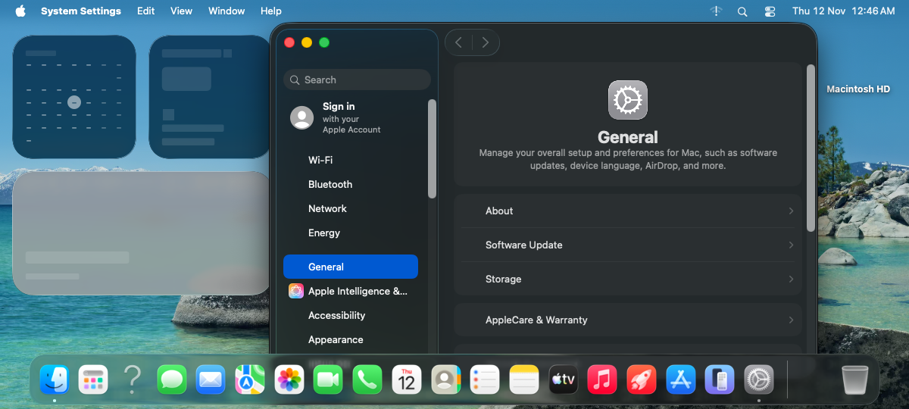
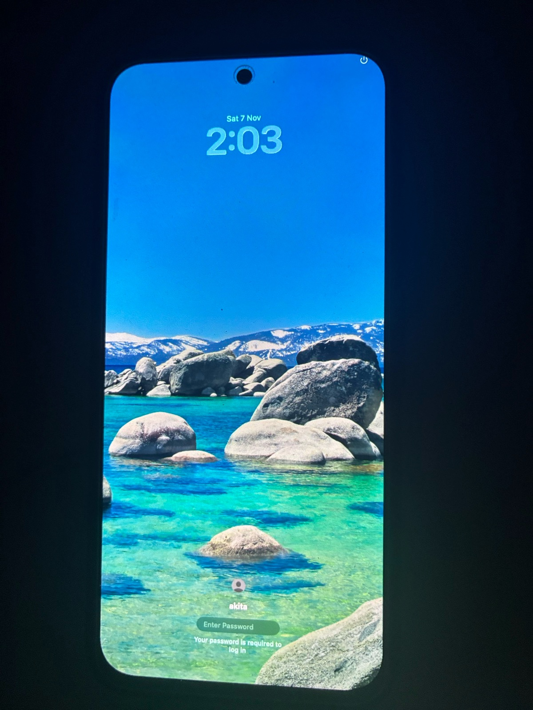
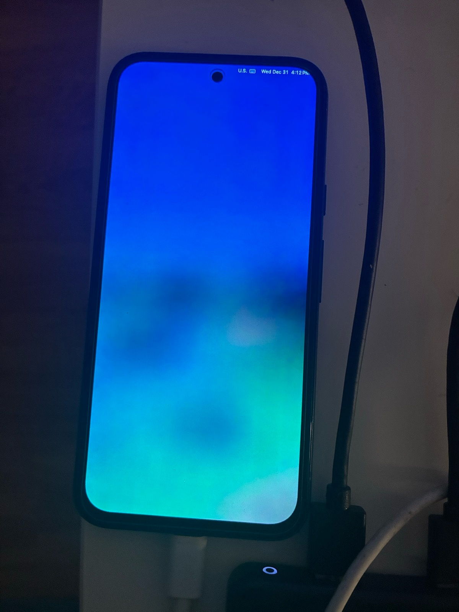

# macOS 26 on a Google Pixel 8a (akita), GPU-accelerated on the Mali

Experimental port of **macOS 26.5 Tahoe (25F71)** to the **Google Pixel 8a** ("akita": Google Tensor G3 "zuma" SoC,
**Mali-G715 MC7** GPU). The full OS boots from RAM (`fastboot boot`, nothing is flashed) to the desktop.
**WindowServer composites on the Mali GPU** through Metal → metal2vulkan → Mesa PanVK, driven by our own IOKit
Mali CSF driver in the kernel. The touchscreen works, with gestures.

<p align="center">
  
</p>
<p align="center">
  
  
</p>

> ⚠️ **Research project, not a daily driver.** This repository contains **no Apple binaries and no ARM firmware**:
> get them legally yourself (Apple's IPSW, the vendor partition of your own phone).

## Status

| Milestone | Status |
|---|---|
| XNU (DEVELOPMENT kernel) boots on the Tensor G3, from RAM with `fastboot boot` | ✅ |
| macOS Recovery with menu bar, Disk Utility, Terminal, Safari | ✅ |
| Full macOS to the desktop (Finder, Dock, System Settings, Terminal), autologin | ✅ |
| Own IOKit driver for the Mali-G715 (CSF: MCU firmware, MMU, queue groups) | ✅ |
| Vulkan (Mesa PanVK ported to Darwin arm64e) | ✅ |
| Metal over Vulkan (metal2vulkan): `MTLCreateSystemDefaultDevice` = "Mali-G715 MC7" | ✅ |
| **WindowServer composites on the GPU** (SkyLight's Metal compositor) | ✅ |
| Dark mode, Liquid Glass (transparency) and wallpaper at boot | ✅ |
| **Touchscreen** (Goodix on SPI, our own driver) with gestures: tap, drag, long press = right click, two-finger scroll | ✅ |
| Window dragging: 15.7 → ~22 → **~50–55 fps** (batched GPU submits, early swap completion, PanVK fast paths; 10-minute drag test: median 55.6 fps) | ✅ (goal: 60) |
| GPU stable under stress (ring-full fault fixed; two jobs of slack counted from the job the GPU is in) | ✅ |
| **Real clock**: boots with the time from the PMIC's RTC (S2MPG14), kept in sync | ✅ |
| Autologin straight to the desktop with the persistent session | ✅ |
| CPU thermal regulator (step down at 85 °C, step back up below 75 °C) | ✅ |
| **Persistent home and settings**: the user's files survive a reboot (APFS volume in a window of `userdata`) | ✅ |
| **Swap on flash** (real swapfiles, 2–6 GB under pressure) | ✅ |
| **RAM: macOS sees 5.98 GiB** (was 4 GiB; UEFI heap moved, all 8 GiB declared, integrity-tested) | ✅ |
| **Boot: `fastboot boot` → desktop in ~2 min** (was ~6.5): no 30 s log pages in DarwinBoot, RELEASE UEFI, rc.server 55 → 19 s (`docs/boot-time.md`) | ✅ |
| **Persistent shader cache** (`/private/var/folders` on the persistent container): WindowServer's pipelines 33 s → 154 ms per boot | ✅ |
| **Battery in the menu bar** (MAX77759 fuel gauge as an IOPMPowerSource: percent, charging, voltage, temperature) | ✅ `pmset -g batt` shows InternalBattery-0; read-only |
| **Display brightness** (MIPI DCS 0x51 to the OLED panel through DSIM0; volume keys step it in the full OS) | ✅ |
| **Disk images** (.dmg: DiskImageMounter, hdiutil) | ✅ AppleDiskImages2, the DiskImages family and HFS+ linked into the kernel; `/Volumes` writable |
| **USB host**: keyboard and mouse through a USB-C hub (our xHCI driver, HID boot protocol) | ✅ plug the hub in and they work in ~20 s (the PD engine starts by itself once the Mac link is gone); mouse cursor drawn; scrolling works; low-speed devices pending; going back to the Mac's USB needs a reboot |
| Stability: hour-long soaks with Wi-Fi/USB checks, 10-minute drag test, critical memory pressure (13.8 GB swap) | ✅ (the "hangs" after 1 h were the watchdog boot-arg `akita-wdt-pet-seconds=3600`: now pets for good) |
| 60 fps (WindowServer's main thread is CPU-bound in the Metal bridge) | 🔧 in progress |
| Wi-Fi (BCM4383 on PCIe): **joins WPA2 at boot, DHCP, internet (DNS, HTTPS)**; kernel log, shell and fastboot reset over Wi-Fi; no Wi-Fi menu yet (`en1` is not an IOKit interface) | ✅ works, `docs/wifi-bringup.md` |
| USB-C: Power Delivery and DisplayPort alternate mode (MAX77759 TCPC) | ✅ PD contract, host role, DP mode configured with a USB-C HDMI hub; video output next, see `docs/research-hdmi-usbc.md` |

More photos in [`photos/`](photos/).

## How graphics acceleration works

```
WindowServer (SkyLight, CompositorMetal) ─┐
CoreAnimation / apps                      ├─ Metal.framework
                                          │    └─ NativeMaliMetal.bundle  (Metal plugin, /System/Library/Extensions)
                                          │         └─ NativeBridgeMetalFrontend (UniXNU) + metal2vulkan (Rust)
                                          │              └─ Mesa PanVK (libvulkan_panfrost.dylib, ported to macOS arm64e)
                                          │                   └─ darwin-drm (libdrm stand-in: Panthor ioctls → IOKit)
                                          │                        └─ MaliClient (IOUserClient)
XNU kernel ───────────────────────────────┘                             └─ Mali.cpp: Mali-G715 CSF driver + IOAccelerator
                                                                         NativeGOPDisplay: copies frames to the panel
```

What WindowServer needed to use the GPU (details in the plugin code and the kernel patches):

1. **Metal discovery**: the driver publishes an `IOAccelerator` with `MetalPluginName = NativeMaliMetal`; Metal loads the
   bundle and calls `initWithAcceleratorPort:`.
2. **WindowServer is a platform binary with library validation and a sandbox**: with the boot-arg `akita-mali-platform=1` the
   kernel marks the ad-hoc signed bundle as platform code and lets it open `MaliClient`, skipping the MACF check and the
   sandbox filter.
3. **`[MTLDevice acceleratorPort]`**: CoreDisplay ties each display to the accelerator this method returns. Our device returned 0,
   so SkyLight fell back to `compositor_sw`. The plugin now answers with the real `IOAccelerator` service.
4. **`WSSystemCanCompositeWithMetal`**: on 25F71 this SkyLight check stays "no" even with a device. As a workaround the plugin
   marks it passed when loaded inside WindowServer (only on 25F71, after checking the expected instructions).

### Performance work (Nov 2026)

- **Batched queue submits** (`MALI_GROUP_SUBMIT_BATCH`): one IOKit call per ~32 jobs instead of one per job (each call cost ~36 µs,
  ~170 per frame). Cross-queue waits are done by the GPU (`SYNC_WAIT64`), not by the CPU.
- **Flush-ID page** mapped read-only to user space, so PanVK skips cache flushes the GPU already did.
- **Early swap completion** in the display driver: the swap completes when it is taken and the copy waits on the GPU fence.
- **PanVK**: 128-byte alignment for tiled images (Metal's alignment), so the bridge no longer keeps shadow copies of heap
  textures; render target and push-constant descriptors built locally and stored once (GPU memory is uncached).
- **GPU ring protection**: a queue's 64 KiB ring is never filled completely (a full ring raised `CS_CONFIG_FAULT`).
- Profiling tools for live stacks of WindowServer: `scripts/stacks.py`, `allstacks.py`, `sysyms.py`, and `drag60.py` to
  measure window-drag fps over the USB input channel.

The remaining limit is CPU time in the Metal → Vulkan bridge on WindowServer's main thread (~150 µs per draw).

## Persistent storage and memory

The system volume stays read-only, as on a Mac; the user's home now lives on a persistent APFS volume and swap goes to
flash. `NativeUfs` publishes a 64 GiB window of `userdata` as a disk (`AkitaDataDisk.h`, boot-arg `akita-data-disk=2`);
`rc.server` formats it on first use (only if it is blank), mounts the home at `/Users/akita` and the swap volume at
`/System/Volumes/VM`. macOS now sees 5.98 GiB of the phone's 8 GiB. Details in
[`docs/storage-and-memory.md`](docs/storage-and-memory.md).

## Touchscreen

The Pixel 8a's touch controller is a Goodix "nottingham" (Berlin family) on SPI. The firmware runs from the chip's own flash,
so the driver only powers it and reads touches (it never writes the chip's flash). `platform-akita/drivers/Acpm/AkitaTouch.inc`:

- rails through the PMIC (S2MPG14 via ACPM): LDO25M 1.8 V and LDO4M 3.0 V; reset and interrupt GPIOs;
- USI/SPI master setup, chip info at `0x10070`, touch data read and acknowledged when the interrupt line drops;
- a gesture state machine: tap = click, drag, long press = right click, two fingers = scroll wheel;
- delivery into `NativeRecoveryInput`'s absolute HID tablet, rotated to the landscape desktop.

Protocol notes in [`docs/research-touch.md`](docs/research-touch.md).

## Repository layout

| Path | What it is |
|---|---|
| `patches/xnu-12377.121.6-akita.patch` | Changes on XNU 12377.121.6 (macOS-ForSheng's and akita's: full-OS rc.server, MaliClient, platform, dark mode at boot, `akita-tfp`…). SSH keys are placeholders: generate your own. |
| `patches/macOS-ForSheng-ca57db7.patch` | Changes on [CrossDarwin/macOS-ForSheng](https://github.com/CrossDarwin/macOS-ForSheng) `ca57db7`. |
| `platform-akita/` | akita platform for macOS-ForSheng (goes in `platform/akita/`): Mali CSF driver, ACPM (CPU clocks, thermal regulator, PMIC) and touch, UFS, input, ADT, image packaging, display driver patches (`patches/display-*`) and the ArmCpu patch. |
| `patches/mesa-2648b20-akita.patch` | Mesa main `2648b20`: PanVK on Darwin (kmod over MaliClient, memory, cache, fast paths). |
| `darwin-drm/` | libdrm stand-in that serves PanVK's Panthor ioctls and DRM syncobjs through the Mali IOKit user client (batched submits, GPU-side waits, flush-ID page). |
| `patches/UniXNU-a3faa4a.patch` | Changes on [UniXNU](https://github.com/UniXNU/UniXNU) `a3faa4a`, including its AdrenoMetal Metal frontend and bridge (`8160223`) and a new metal2vulkan patch (`0031`). |
| `patches/metal2vulkan-624bab39-akita-heap-diag.patch` | A diagnostic in metal2vulkan's heap textures (why a texture gets a shadow image). |
| `plugin/` | `NativeMaliMetal.bundle`: the Metal plugin (UniXNU frontend + metal2vulkan + PanVK), with live profilers. |
| `tools/` | Tests (Vulkan, Metal, `metaldiscover`) and WindowServer inspection (`wsvars`, `wswatch`, `wssample`, `wsstack`, `wsfind`…). |
| `scripts/` | Image build (`build-fullos.sh`), Mali/ACPM/bridge/darwin-drm/PanVK builds, test cycles, USB shell/log, profilers. |
| `uefi-akita/` | The akita platform for Mu-Silicium (`akitaPkg`, `S5P9865Pkg`): memory map, UFS, keypad. `patches/Mu-Silicium-213bce4-akita.patch` has the changes to its common code. |
| `docs/` | Practical guide, full-OS plan, research notes (GPU, touch, USB-C video), storage and memory, development log. |

The scripts contain absolute paths of the development machine (`/Volumes/datos2/unixnu-akita/...`): adapt them.

## Requirements (summary)

- Pixel 8a with an unlocked bootloader. Always booted with `fastboot boot` (RAM); no flashing needed.
- Apple's macOS 26.5 (25F71) IPSW for the system and the reference kernelcache.
- CSF firmware from your own phone: `adb pull /vendor/firmware/mali_csffw-r54p2.bin`, then
  `scripts/make-mali-csffw-inc.py` generates `platform-akita/drivers/Mali/mali_csffw.inc` (not redistributed).
- macOS on Apple Silicon with Xcode to build XNU, Mesa (meson/ninja), Rust 1.98 (metal2vulkan with `-Z build-std`).

## Credits

- [macOS-ForSheng](https://github.com/CrossDarwin/macOS-ForSheng): the base for booting macOS 26 on non-Apple hardware.
- [UniXNU](https://github.com/UniXNU/UniXNU): native Metal frontend and metal2vulkan bridge.
- [MaliMetal](https://github.com/Ken-u): darwin-drm, the Mali user-space stack for Darwin we built on.
- [Mesa](https://gitlab.freedesktop.org/mesa/mesa): PanVK / panthor.
- Google's [goodix_touch](https://android.googlesource.com/kernel/google-modules/touch/goodix_touch/) driver (GPL): reference for the touch protocol.
- [nullarc](https://github.com/luuumi-dev/nullarc): reference for a GPU WindowServer over Vulkan.
- [ipsw](https://github.com/blacktop/ipsw): dyld shared cache analysis.
- Apple: XNU is open source under APSL 2.0. macOS, its frameworks and its trademarks belong to Apple; this project is not
  affiliated with Apple or Google.

Much of the late-2026 work (GPU performance, touch, display) was done with Claude (Anthropic); those local changes to PanVK
and the bridge are marked `akita (Generated-by: LLM)` and are not submitted upstream.

## License

Our own code is **GPL-3.0** (see `LICENSE`), compatible with macOS-ForSheng. Patches on third-party projects keep each
project's license (XNU: APSL 2.0; Mesa: MIT; UniXNU, darwin-drm and the drivers in `platform-akita`: BSD-2-Clause-Patent, see
each folder's `LICENSE`). See `THIRD_PARTY.md`.
