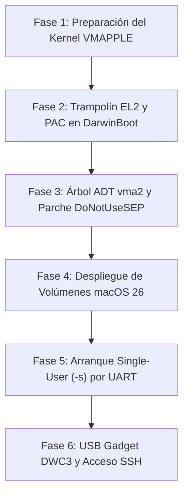

# Investigación: macOS/iPadOS en Pixel 8a (UniXNU)
**Fecha:** 3 de noviembre de 2026  
**Investigador:** Especialista Técnico Senior en Kernels XNU, Arquitectura ARM64 y Firmware SoC

---

## Resumen ejecutivo

1. **Objetivo técnico:** Demostrar la viabilidad de arrancar y operar **macOS 26.5.2 (25F84, kernel xnu-12377.121.6)** en el Google Pixel 8a (*akita*, Google Tensor G3 *zuma*) utilizando UniXNU, aprovechando que el userland de iPadOS 17.7.11 ya ejecuta ~150 procesos en el dispositivo.
2. **Compatibilidad del target VMAPPLE:** El kernel `VMAPPLE` (diseñado para máquinas virtuales invitadas en `Virtualization.framework`) es el camino óptimo porque incluye drivers genéricos estándar (`HAS_GIC_V3`, `PL011_UART`, `AppleVirtualPlatform`, `AppleVirtIOStorage`) y prescinde de los controladores propietarios AIC, SPRR, PPL y SPTM de Apple Silicon bare-metal.
3. **Bloqueo crítico de PAC en EL1/EL2:** `VMAPPLE.h` activa `HAS_PARAVIRTUALIZED_PAC`. Cada cambio de contexto y arranque invoca hipercalls (`hvc #0`) a EL2 (`VMAPPLE_PAC_SET_INITIAL_STATE`, `VMAPPLE_PAC_SET_EL0_DIVERSIFIER`, etc.). Sin un hipervisor en EL2 que responda, el bucle `cbnz x0, .` congela la CPU. Mitigación demostrada: o bien parchear a `nop` las instrucciones `hvc #0` (como en los parches QEMU vmapple de Anees Iqbal), o implementar un vector stub mínimo en EL2 que configure directamente los registros arquitecturales ARMv8.3 (`APIAKey*`, `APIBKey*`) con `HCR_EL2.APK|API = 1`.
4. **Ausencia de SEP en VM y pánico de APFS:** macOS 15+ y macOS 26 panican al montar volúmenes Data sin cifrar si detectan ausencia de Secure Enclave (*"unencrypted data volume is not allowed"*). La solución obligatoria es inyectar la propiedad `/filesystems/DoNotUseSEP` en el Device Tree (ADT/FDT).
5. **SPTM y TXM no aplican a VMAPPLE:** `VMAPPLE.h` define explícitamente `NO_MONITOR 1` y `ARM_PARAMETERIZED_PMAP 1`. El kernel corre en modo directo EL1 con tablas de páginas gestionadas por el propio XNU sin intermediación de Secure Page Table Monitor.
6. **Gránulo de 16 KiB verificado en hardware:** El Tensor G3 soporta 16 KiB (`ID_AA64MMFR0_EL1` con `TGran16=1`). Sus núcleos Cortex-A510, Cortex-A715 y Cortex-X3 manejan 16 KiB de forma nativa (validado comercialmente por Google en el modo 16 KB de Android 15). `__ARM_MIXED_PAGE_SIZE__` permite ejecutar binarios de usuario con alineación de 4 KiB sobre un kernel de 16 KiB.
7. **WindowServer requiere Metal imperativamente:** En Apple Silicon / macOS arm64e, `WindowServer` **no posee fallback por software ni modo VESA/GOP por CPU**. Si no existe acelerador Metal funcional (`AppleParavirtGPU` o driver nativo), `WindowServer` falla en bucle (*crash respawn loop*).
8. **Viabilidad de macOS headless / consola:** macOS **sí puede arrancar hasta una shell interactiva** sin GPU: arrancando en Single-User Mode (`-s`), `launchd` ejecuta `/bin/sh` directamente sobre la consola de texto/UART (`/dev/console`). Alternativamente, levantando red mediante USB Gadget (DWC3 NCM/ECM), es posible acceder vía SSH.
9. **Arranque SMP secundario:** XNU VMAPPLE despierta CPUs secundarias invocando PSCI 0.2 `CPU_ON` (`0xC4000003`). En el Pixel 8a, ATF despierta los núcleos en EL2; es imperativo interceptar el punto de entrada con un trampolín que configure `HCR_EL2` (RW=1, APK=1, API=1) antes de saltar a `LowResetVectorBase` en EL1.
10. **GPU Mali-G715 (CSF / Valhall v11):** Es un componente con firmware propietario de microcontrolador Command Stream Frontend (`mali_csffw.bin`). Encenderla requiere una secuencia compleja: dominios `pd_g3d`/`pd_embedded_g3d`, interacción por buzón con el coprocesador ACPM (DVFS `ACPM_DVFS_G3D`), y desbloqueo de S2MPU.
11. **Estado de PanVK y Metal sobre Vulkan:** Mesa PanVK para Mali v11 es experimental, no pasa Khronos CTS y exige `PAN_I_WANT_A_BROKEN_VULKAN_DRIVER=1`. Carece de extensiones indispensables para `metal2vulkan` (*descriptor indexing*, *buffer device address*, *timeline semaphores*). No existe ningún build de PanVK para Darwin Mach-O.
12. **Precedente de GPU en UniXNU:** En Qualcomm (`sheng`, Snapdragon 8 Gen 2 / Adreno 740), UniXNU logró compositing real usando `metal2vulkan` + Turnip. En Mali (`merlinx`, Mali-G52), el intento `NativeMaliGpuService` llegó a encender voltajes y leer VSRAM, congelándose inmediatamente.
13. **USB Gadget DWC3:** Zuma integra una controladora Synopsys DWC3 en `0x11210000` con PHY Exynos USBDRD en `0x11100000`. Adaptar `NativeDwc3` a XNU para publicar funciones NCM/ECM o `AppleUSBDeviceMux` es el paso crítico para tener consola interactiva y depuración remota.
14. **Pantalla nativa vs GOP:** La pantalla del Pixel 8a utiliza el controlador DECON (`0x19470000`) + DSIM (`0x19440000`) sobre un panel Samsung OLED (`google,ak3a`). Reutilizar el framebuffer GOP inicializado por Mu-Silicium (`0xFAC00000`) como un `IOFramebuffer` plano de macOS es la vía viable a corto plazo para mostrar texto o consolas de pánico.
15. **Ruta recomendada:** Descartar a corto plazo la aceleración Metal sobre Mali-G715 (estimada en 9–18 meses de desarrollo de alto riesgo). Enfocar el esfuerzo en **macOS 26 Headless / Consola**: Trampolín EL2 para PAC/SMP → inyección de `/filesystems/DoNotUseSEP` → montaje de `userdata` (ShengUfs) + SystemOS/Cryptex → arranque de `launchd -s` con shell en UART PL011 y SSH sobre USB DWC3.

---

## A. macOS como «Mac virtual» en hardware no Apple

### A1. Requisitos del kernel VMAPPLE y plataforma `vma2`

El kernel compilado con la configuración de máquina `VMAPPLE` (`pexpert/arm64/VMAPPLE.h`) fue introducido por Apple para permitir la virtualización ligera de macOS dentro del hipervisor nativo de macOS (`Virtualization.framework`) sobre procesadores Apple Silicon (M1 a M4).

#### Definiciones clave en `pexpert/arm64/VMAPPLE.h`:
```c
#define NO_MONITOR                1
#define NO_ECORE                  1
#define HAS_PARAVIRTUALIZED_CTRR  1
#define VMAPPLE                   1
#define APPLEVIRTUALPLATFORM      1
#define CPU_HAS_APPLE_PAC         1
#define HAS_PARAVIRTUALIZED_PAC   1
#define HAS_GIC_V3                1
#define HAS_ARM_FEAT_SSBS2        1
#define HAS_ARM_FEAT_SME          1
#define HAS_ARM_FEAT_SME2         1
#define HAS_ARM_FEAT_PAN3         1
#define __ARM_PAN_AVAILABLE__     1
#define __ARM_16K_PG__            1
#define __ARM_RANGE_TLBI__        1
#define ARM_PARAMETERIZED_PMAP    1
#define __ARM_MIXED_PAGE_SIZE__   1
#define PL011_UART                1
#define PLATFORM_PANIC_LOG_DISABLED 1
#define GIC_SPURIOUS_IRQ          1023
#define GICR_PE_SIZE              0x20000
```

#### Estructura del Árbol de Dispositivos (ADT / DeviceTree.vma2macosap):
A diferencia del árbol DT de bare-metal (que incluye AIC, PMGR propietario, fabric Apple, SEP, etc.), el árbol de `vma2macosap` (`VirtualMac2,1`, `ApChipID 0xFE00`, `BoardID 0x20`) presenta una topología limpia y estándar:

1. **Raíz `/`:**
   - `model = "VirtualMac2,1"`
   - `compatible = "apple,vma2", "apple,arm-platform"`
   - `#address-cells = <2>`, `#size-cells = <2>`
2. **Nodo `/chosen`:**
   - `boot-args`: Cadena de argumentos (p. ej. `-v debug=0x14e keepsyms=1`).
   - `firmware-version`: Versión de iBoot/AVPBooter.
   - `system-id` / `machine-id`: UUIDs de la instancia.
   - `memory-map`: Nodos embebidos describiendo las regiones de memoria reservada (ramdisk, trust cache, DeviceTree, boot-args).
3. **Nodo `/cpus`:**
   - Un subnodo por vCPU (`cpu@0`, `cpu@1`, ...).
   - Propiedades: `device_type = "cpu"`, `reg = <MPIDR>`, `enable-method = "psci"`, `clock-frequency`.
4. **Nodo `/arm-io` (Primary Bus):**
   - Subnodo `/arm-io/gic`: Compatible con `"arm,gic-v3"`. Registros GICD (`0x10400000` en zuma) y GICR (`0x10440000`, redistribuidores con stride de `0x20000`).
   - Subnodo `/arm-io/uart`: Compatible con `"arm,pl011"`.
   - Subnodo `/arm-io/virtio-mmio`: Bloques VirtIO estándar para almacenamiento (`apple-virtio,mmio` o `virtio,mmio`).
5. **Nodo `/psci`:**
   - `compatible = "arm,psci-0.2"`, `"arm,psci"`
   - `method = "hvc"` (o `"smc"`)
6. **Nodo `/memory`:**
   - Región base de DRAM física usable por el sistema.
7. **Nodo `/filesystems`:**
   - Contenedor de flags de políticas para APFS/VFS.

---

### A2. Hipercalls (HVC) e interfaces paravirtuales

macOS bajo `APPLEVIRTUALPLATFORM` implementa llamadas de hipervisor conformes a la especificación ARM SMCCC (ARM DEN 0028F) con identificadores propietarios de Apple definidos en `osfmk/arm64/hv_hvc.h`:

```c
#define HVC_FID_FAST_CALL            0x80000000
#define HVC_FID_HVC64                0x40000000
#define HVC_FID_CPU                  0x01000000
#define HVC_FID_OEM                  0x03000000
#define HVC_FID_HYPERVISOR_VENDOR    0x06000000

/* Apple CPU Services (PAC paravirtualizado) */
#define VMAPPLE_PAC_SET_INITIAL_STATE          0xC1000000
#define VMAPPLE_PAC_GET_DEFAULT_KEYS           0xC1000001
#define VMAPPLE_PAC_SET_A_KEYS                 0xC1000002
#define VMAPPLE_PAC_SET_B_KEYS                 0xC1000003
#define VMAPPLE_PAC_SET_EL0_DIVERSIFIER        0xC1000004
#define VMAPPLE_PAC_SET_EL0_DIVERSIFIER_AT_EL1 0xC1000005
#define VMAPPLE_PAC_SET_G_KEY                  0xC1000006
#define VMAPPLE_PAC_NOP                        0xC10000F0

/* Apple OEM Services */
#define VMAPPLE_GET_MABS_OFFSET                0xC3000003
#define VMAPPLE_GET_BOOTSESSIONUUID            0xC3000004
#define VMAPPLE_VCPU_WFK                       0xC3000005
#define VMAPPLE_VCPU_KICK                      0xC3000006

/* PSCI Standard Services */
#define PSCI_FN_ID_CPU_OFF                     0x84000002
#define PSCI_FN_ID_SYSTEM_SUSPEND              0xC400000E
#define PSCI_FN_ID_CPU_ON                      0xC4000003
```

#### Comportamiento e impacto en hierro real:
- **PAC Paravirtualizado:** En `osfmk/arm64/pac_asm.h` y `machine_routines_apple.c`, el kernel ejecuta:
  ```assembly
  mov x0, #VMAPPLE_PAC_SET_INITIAL_STATE
  hvc #0
  cbnz x0, .
  ```
  Si no hay hipervisor en EL2 que responda 0 en `x0`, el kernel se congela instantáneamente en `cbnz x0, .`.
- **Reemplazo en Bare Metal (Dos alternativas):**
  1. *Opción A (Parche en kernel / Recompilación):* Desactivar `HAS_PARAVIRTUALIZED_PAC` en `VMAPPLE.h`. En su lugar, inicializar las claves directamente en los registros arquitecturales ARMv8.3 (`APIAKeyLo_EL1`, `APIBKeyLo_EL1`, etc.). Esto requiere que el firmware en EL2 haya dejado `HCR_EL2.APK=1` y `HCR_EL2.API=1`.
  2. *Opción B (EL2 Micro-Stub en DarwinBoot):* Mantener un manejador de excepciones mínimo en EL2. Al recibir un `hvc #0` con `x0 = 0xC1000000`–`0xC1000006`, el stub simula la llamada, escribe las claves físicas en los registros del core invocador y retorna `x0 = 0` mediante `eret`.
- **Reloj y BootSession:**
  - `VMAPPLE_GET_MABS_OFFSET`: Retorna el desfase entre el timer virtual y el físico. En bare metal, si falla, XNU asume un offset de 0 (`ml_get_abstime_offset() = 0`).
  - `VMAPPLE_GET_BOOTSESSIONUUID`: Si el host no responde, el kernel genera un UUID aleatorio mediante entropía interna.

---

### A3. Precedentes: macOS Apple Silicon fuera de Mac y Virtualization.framework

1. **QEMU `vmapple` (Alexander Graf):**
   - Presentado en 2023–2024 en la lista de correo de QEMU (`hw/vmapple/`).
   - Implementó emulación limpia en userspace del dispositivo de configuración (`cfg.c`), puerta trasera (`bdif.c`), acelerador AES (`aes.c`) y un bloque VirtIO block personalizado que implementa barreras Apple (`VIRTIO_BLK_T_APPLE_BARRIER`).
   - Funcionó sobre hosts Apple Silicon usando `Hypervisor.framework` (HVF) sin pasar por las restricciones de `Virtualization.framework`.
2. **Parches para macOS 14/15 en QEMU vmapple (Anees Iqbal):**
   - *Problema 1:* macOS 14+ comenzó a emitir llamadas HVC para PAC que el HVF público de Apple no redirigía correctamente a QEMU, dejando la CPU en un bucle infinito en `hvc #0; cbnz x0, .`. *Solución:* Capturar fallos de ejecución en el salto del kernel y parchear dinámicamente (`nop`) las secuencias HVC de PAC.
   - *Problema 2:* macOS 15 panica con *"unencrypted data volume is not allowed"* al no detectar Secure Enclave. *Solución:* Inyectar el nodo `/filesystems/DoNotUseSEP` en el árbol FDT.
3. **`macOS-ForSheng` (Jelly10086):**
   - Primer proyecto comunitario en demostrar el arranque del kernel de macOS 26.5 / 25F71 y el userland arm64e de Recovery en hardware Android comercial (Xiaomi 13 / SM8550 Snapdragon 8 Gen 2).
   - Logró el montaje de `BaseSystem` e ISC, creación de volumen Data temporal y ejecución exitosa de `launchd`. Se detuvo en `WindowServer`, que se estrella repetidamente durante la inicialización de HID y pantalla al no encontrar Metal.
4. **Corellium:**
   - Virtualización comercial de iOS y macOS en servidores ARM64 Ampere Altra y Apple Silicon. Desarrollaron shims propietarios en EL2 para interceptar llamadas de PAC, AIC y MMU, exponiendo dispositivos de bloque y red virtualizados.

---

### A4. Seguridad y verificación en macOS 26 VM

| Componente | Requisito en Apple VM | Adaptación en UniXNU (Pixel 8a) |
| :--- | :--- | :--- |
| **Image4 / AP Ticket** | En VM se usa `config_pv_ticket`. El booter valida un ticket generado con el ECID virtual. | UniXNU omite la validación de tickets de Apple mediante el cargador `DarwinBoot`, inyectando argumentos limpios en `boot_args`. |
| **SSV (Signed System Volume)** | El volumen del sistema debe coincidir con el hash raíz firmado en el árbol de confianza. | UniXNU utiliza el kext `VerifiedRoot` y políticas locales firmadas con una clave RSA-3072 del propietario (`owner-policies`), verificando los bloques UFS al vuelo. |
| **Sellado de volumen** | macOS 26 requiere que el APFS System Snapshot esté sellado. En imágenes de restauración no selladas, el kernel exige bandera de desarrollo. | El volumen System extraído del IPSW de macOS 26.5.2 no está sellado criptográficamente por Apple; se monta bajo política de desarrollador o mockfs verificado por hash. |
| **AMFI / Launch Constraints** | AMFI aplica restricciones de firmas a daemons del sistema y launch constraints a ejecutables del cryptex. | En perfiles UniXNU se compila el kernel con `amfi=0xff` o `amfi_get_out_of_my_way=1` en `boot-args`, y parches en `amfi.c` para permitir binarios con firmas ad-hoc. |
| **Cryptexes (`SystemOS`, `AppOS`)** | macOS monta `SystemOS.cryptex` sobre `/System/Volumes/Preboot/Cryptexes` y realiza un *union mount* sobre `/System`. | Se replica la misma arquitectura que ya funciona en el perfil iPadOS 17.7.11 del Pixel 8a: `DarwinBoot` carga el cryptex descifrado en RAM disk y el kernel realiza el montaje de unión. |
| **SPTM / TXM** | Secure Page Table Monitor / Trusted Execution Monitor (obligatorio en bare-metal M3/M4 e iOS 17+). | **No aplica a VMAPPLE.** `VMAPPLE.h` fija `NO_MONITOR 1`. El kernel gestiona sus tablas de páginas mediante pmap parametrizado directo en EL1. |
| **Secure Enclave (SEP)** | En hardware real gestiona FileVault y llaves de volumen. En VM no hay hardware SEP. | Se requiere inyectar el nodo `/filesystems/DoNotUseSEP` en el Device Tree para que APFS permita montar volúmenes Data sin cifrar. |

---

### A5. Soporte de páginas de 16 KiB en Tensor G3

1. **Requisitos de XNU macOS:**
   - macOS arm64e requiere de forma estricta un tamaño de página de kernel de 16 KiB (`__ARM_16K_PG__ 1`).
   - Soporte de procesos mixtos: `__ARM_MIXED_PAGE_SIZE__ 1` permite al pmap reconfigurar `TCR_EL1` por proceso para admitir ejecutables heredados de 4 KiB conviviendo con el kernel de 16 KiB.
2. **Capacidades del hardware Tensor G3 (zuma):**
   - El registro `ID_AA64MMFR0_EL1` leído en el Pixel 8a arroja `0x22200101122`, donde el campo `TGran16` (bits 23:20) es `0x1`, confirmando **soporte completo de gránulo de 16 KiB**.
   - Los núcleos Cortex-A510 (LITTLE), Cortex-A715 (MID) y Cortex-X3 (BIG) implementan MMU ARMv9.0-A con TLB unificada capaz de manejar páginas de 16 KiB y bloques contiguos de 2 MiB / 32 MiB sin penalización de rendimiento.
3. **Validación comercial:**
   - Google seleccionó el Pixel 8 / 8a como dispositivo de referencia para el soporte de 16 KB en Android 15. Todo el silicio de Tensor G3 (controladores de memoria LPDDR5, SysMMU v7, buses NoC) opera de forma estable bajo 16 KB.

---

### A6. Entorno de usuario sin GPU: Shell vs WindowServer

1. **WindowServer y Metal:**
   - En macOS moderno (11.0 a 26+), `WindowServer` delega la totalidad de la composición de capas a Metal (`QuartzCore / CoreAnimation`).
   - A diferencia de Linux (que dispone de renderizado por software en Pixman/Mesa llvmpipe para X11/Wayland), **macOS no incluye un backend de renderizado por CPU para WindowServer**.
   - En una máquina virtual sin `AppleParavirtGPU`, o en hardware real sin kext de aceleración Metal, `WindowServer` intenta abrir el dispositivo Metal por defecto, falla con `MTLCreateSystemDefaultDevice() == nil`, emite un mensaje de pánico en el registro y `launchd` lo mata con señal de salida, repitiendo el intento indefinidamente.
2. **Modos de arranque viables sin GPU:**
   - **Single-User Mode (`-s` en `boot-args`):** En `xnu/bsd/kern/kern_exec.c:7974`, cuando se pasa `-s`, `launchd` recibe `-s` en `argv[1]` y omite el arranque de daemons gráficos, spawneando directamente una consola de comandos `/bin/sh` sobre `/dev/console`.
   - **Consola de texto por UART:** Con `PL011_UART` configurado en `0x10870000`, la consola `/bin/sh` es accesible mediante cable serial o adaptador de depuración.
   - **Acceso remoto por SSH:** Modificando los archivos plist en `/System/Library/LaunchDaemons/ssh.plist` o preconfigurando la partición Data para iniciar `sshd`, el sistema puede operar de forma headless a través de red.
   - **`serverperfmode=1`:** Ajusta parámetros de memoria y límites de descriptores en Mach, pero no inhabilita la interfaz gráfica por sí mismo.

---

### A7. Arranque multiprocesador (SMP)

1. **Mecanismo de llamada en XNU VMAPPLE:**
   - La función `PE_cpu_start_internal()` en `iokit/Kernel/arm/AppleARMSMP.cpp` invoca:
     ```cpp
     gPMGR->enableCPUCore(cpu_id, ml_vtophys(reset_vector_vaddr));
     ```
   - El driver `ArmCpu` de UniXNU traduce esta llamada a una petición estándar de PSCI 0.2:
     ```cpp
     psciCall(hvc, 0xC4000003, affinity, entry, 0); // PSCI CPU_ON (64-bit)
     ```
2. **Problema de elevación EL2 / EL1 en el despertar:**
   - En el Google Pixel 8a, el monitor seguro ATF (Arm Trusted Firmware en EL3) recibe la llamada `CPU_ON` y arranca los núcleos secundarios en el nivel no seguro más alto disponible: **EL2**.
   - El vector de reseteo del kernel (`LowResetVectorBase` en `osfmk/arm64/start.s`) asume ejecución en **EL1**. Si entra en EL2, cualquier manipulación de registros de sistema pensados para EL1 (`msr OSLAR_EL1, xzr`, `msr VBAR_EL1, x0`) o el intento de activar la MMU con formato EL1 causará una excepción fatal inmediata.
   - Además, si no se programa `HCR_EL2.APK` y `HCR_EL2.API`, cualquier instrucción PAC en el arranque secundario generará un trap de excepción no atendido.
3. **Solución necesaria:**
   - Configurar la dirección `entry` del PSCI apuntando a un **trampolín EL2** en memoria contigua.
   - El trampolín debe:
     1. Desactivar trampas de coprocesador y PAC: `HCR_EL2 = (3 << 40) | (1 << 31)` (APK=1, API=1, RW=1).
     2. Habilitar la interfaz del GICv3 para EL1: `ICC_SRE_EL2 = 0xF`.
     3. Configurar temporizadores: `CNTHCTL_EL2 = 0x3`, `CNTVOFF_EL2 = 0`.
     4. Limpiar `SCTLR_EL1` y retornar mediante `eret` al punto de entrada físico de `LowResetVectorBase` en EL1.

---

## B. GPU Mali‑G715 (Tensor G3) para iOS/macOS

### B1. Estado de `panthor` en Linux para Mali v11 / G715

1. **Arquitectura:** Mali-G715 es una GPU basada en la arquitectura **Valhall v11** (10ª/11ª generación de Mali) que abandona el modelo tradicional de colas Job Manager (JM) de Bifrost/Valhall v9 e introduce el **Command Stream Frontend (CSF)**.
2. **Firmware CSF (`mali_csffw.bin`):**
   - El subsistema CSF integra un microcontrolador (basado en Cortex-M) dentro de la propia GPU que procesa las colas de comandos.
   - Requiere un firmware binario firmado por Arm ubicado en Linux bajo `/lib/firmware/arm/mali/arch11.0/mali_csffw.bin`.
   - El firmware de Google para Android se ubica en la partición `/vendor/firmware/mali_csffw.bin`. Ambos comparten el mismo formato binario de cabecera y ABI de interfaz con kbase/panthor.
3. **Secuencia de encendido en el driver:**
   - Activar reguladores de voltaje externos y conmutar dominios de energía.
   - Habilitar relojes de interfaz AXI y reloj principal de sombreadores.
   - Liberar el reset del hardware CSF.
   - Mapear el firmware CSF en una región contigua de memoria física accesible por la MMU de la GPU.
   - Escribir la dirección física en los registros de arranque del MCU y enviar la señal de inicio.
   - Esperar la confirmación del handshake (*firmware boot handshake ack*).

---

### B2. Secuencia de encendido en Tensor G3 (`mali_kbase` + `mali_pixel`)

En el árbol de controladores de Google (`android-gs-*-kernel` / `private/google-modules/gpu/mali_kbase` y `mali_pixel`), el encendido de la GPU en *zuma* sigue un protocolo altamente dependiente del SoC:

1. **Dominios de potencia:**
   - `power-domains = <&pd_g3d>, <&pd_embedded_g3d>;`
   - `pd_g3d` energiza la lógica superior (*top-level logic*, interfaces de bus y cachés L2).
   - `pd_embedded_g3d` energiza los clústeres de núcleos de cómputo (*cores*).
   - El estado real del PMU se sondea en el registro `gpu_pmu_status_reg_offset = <0x1C84>` con máscara `0x1`.
2. **Interacción con ACPM (Access Control and Power Management):**
   - Zuma no permite a la CPU conmutar los divisores de reloj de la GPU directamente en los registros del CMU.
   - Se debe enviar un mensaje IPC a través del buzón de correo (*mailbox*) al coprocesador ACPM solicitando las frecuencias DVFS usando los identificadores:
     - `gpu0_cmu_cal_id = <ACPM_DVFS_G3DL2>` (Reloj de caché L2, hasta 950 MHz).
     - `gpu1_cmu_cal_id = <ACPM_DVFS_G3D>` (Reloj de núcleos de GPU, hasta 940 MHz).
3. **Seguridad y MMU (S2MPU y SysMMU):**
   - Delante de la GPU se encuentra una unidad de protección de segundo nivel `s2mpus = <&s2mpu_s0_g3d>;`. Si el firmware de seguridad (TrustZone / EL3) no la ha dejado abierta, cualquier acceso DMA de la GPU causará un bloqueo del bus del sistema.
4. **MGM y SLC:**
   - La gestión de memoria utiliza el gestor `arm,physical-memory-group-manager` con la partición SLC `gpu_write_alloc` para asignar transacciones hacia la System Level Cache compartida de Tensor G3.

---

### B3. Mesa PanVK en Valhall v11

1. **Estado de soporte:**
   - El soporte para Valhall v11 / G715 en Mesa PanVK es **experimental y no conforme**.
   - Para que el loader de Vulkan lo cargue en Linux, es imprescindible exportar:
     ```bash
     export PAN_I_WANT_A_BROKEN_VULKAN_DRIVER=1
     ```
2. **Resultados de conformidad (CTS):**
   - Aunque se han implementado características básicas de Vulkan 1.0 y 1.1, falla múltiples pruebas de la suite de conformidad Khronos (VK-GL-CTS) en la gestión de memoria de descriptores y barreras CSF.
3. **Compilación en Darwin / Mach-O:**
   - **No existe ningún antecedente ni commit público** en el repositorio de Mesa que compile PanVK bajo formato Mach-O o lo enlace con las cabeceras del subsistema IOKit de Apple. Todo el código de PanVK asume Linux DRM/DRI3 o el subsistema Sync Framework de Android.

---

### B4. Ruta Metal sobre Vulkan (`metal2vulkan` / Turnip vs PanVK)

1. **El éxito en Qualcomm (Adreno 740):**
   - UniXNU utiliza `AdrenoMetal` en el Xiaomi 13 (*sheng*) porque la combinación de **metal2vulkan** y **Turnip** (el driver Vulkan para Adreno en Mesa) es madura, pasa Vulkan 1.3 CTS y soporta extensiones avanzadas requeridas por Metal:
     - `VK_EXT_pipeline_creation_cache_control`
     - `descriptorIndexing` con enlaces no homogéneos (*partially bound*)
     - `bufferDeviceAddress` (64 bits)
     - `timelineSemaphore`
     - `dynamicRendering`
2. **Inviabilidad actual de PanVK:**
   - PanVK en v11 **no cumple con la totalidad de estas extensiones**. Intentar enlazar `metal2vulkan` contra PanVK provoca fallos de aserción inmediatos durante la consulta `vkGetPhysicalDeviceFeatures2`.
3. **Alternativas evaluadas:**
   - *Zink (OpenGL sobre Vulkan):* No soluciona el problema de Metal, ya que iOS/macOS moderno no utiliza OpenGL para `WindowServer`.
   - *Emulación de virtio-gpu:* Requeriría un hipervisor intermedio ejecutando un Linux invitado con Panthor que actúe como host de virtio, agregando una penalización masiva de rendimiento y complejidad.

---

### B5. Precedentes en UniXNU: El intento en `merlinx` (Mali-G52)

En el port para el Redmi Note 9 (*merlinx*, MediaTek MT6768 Helio G85 con Mali-G52 Bifrost), el desarrollador Dracen-W implementó el kext `NativeMaliGpuService.cpp`:
- El kext lograba hacer coincidir el nodo ADT, mapear los rangos de memoria MMIO y ejecutar los primeros pasos de encendido (`MALI MATCH`, `MALI M2P`, `M2V`).
- Sin embargo, el encendido se detuvo en el paso `V1 read VSRAM`: al intentar leer el estado de voltaje de la SRAM del núcleo de la GPU sin la calibración adecuada del PMIC y del subsistema de reloj, el bus colapsó y la CPU se congeló.
- No se llegó a enviar un solo comando de renderizado ni a inicializar la MMU de la GPU.

---

### B6. Estimación realista de esfuerzo por etapas (Mali-G715 en XNU)

| Etapa | Descripción | Dependencias críticas | Esfuerzo estimado |
| :--- | :--- | :--- | :--- |
| **1. Lectura de `GPU_ID`** | Mapear MMIO `0x1F000000`, encender dominios `pd_g3d`/`pd_embedded_g3d`, configurar ACPM y leer registros `0x0000`/`0x0004`. | Protocolo IPC ACPM, clocks CMU. | **2 a 3 semanas** |
| **2. Carga de CSF Firmware** | Cargar `mali_csffw.bin` en RAM física, programar arranque del MCU y completar handshake. | Allocator contiguo coherente en XNU. | **3 a 4 semanas** |
| **3. MMU y Primer Job** | Configurar tablas de páginas Valhall v11, colas CSF, enviar job NOP y recibir interrupción GIC. | Permisos S2MPU, interrupciones GIC. | **4 a 6 semanas** |
| **4. Kext IOKit DRM/Kbase** | Crear interfaz en XNU equivalente a `/dev/dri/card0` para gestión de GEM buffers y envíos. | IOKit MemoryDescriptors, fences. | **6 a 8 semanas** |
| **5. Port de PanVK a Mach-O** | Adaptar Mesa PanVK para compilar en Darwin y comunicarse con el kext IOKit. | Toolchain Mach-O, libsync en XNU. | **3 a 6 meses** |
| **6. metal2vulkan + CA** | Implementar extensiones faltantes en PanVK, bridge con IOSurface y CoreAnimation. | metal2vulkan, soporte swapchain. | **3 a 6 meses** |
| **TOTAL ACUMULADO** | De silicio frío a aceleración gráfica completa en SpringBoard/WindowServer. | Alta especialización en gráficos. | **9 a 18 meses** |

---

## C. Resto del hardware del Pixel 8a para un SO de Apple

### C1. USB en modo dispositivo (DWC3 en zuma)

- **Controlador:** Synopsys DesignWare Cores USB 3.0 (DWC3) ubicado en `0x11210000` (tamaño `0x10000`), configurado como periférico (`dr_mode = "peripheral"`).
- **PHY:** `samsung,exynos-usbdrd-phy` en `0x11100000` con sub-bloques en `0x11110000`–`0x11140000`, dependiente del controlador del sistema `sysreg_hsi0` en `0x11020000` y registros de energía en PMU (`0x3EB0` y `0x3EB4`).
- **Implementación en XNU:**
  - UniXNU cuenta con el diseño de referencia `NativeDwc3` (Lux12138).
  - Para interactuar con el ecosistema de Apple, el driver debe registrarse en la familia `IOUSBDeviceFamily.kext` y presentar una configuración compuesta que exponga:
    1. Una interfaz CDC-NCM o CDC-ECM (Ethernet sobre USB) para obtener una interfaz de red `en0` en XNU que permita depuración y SSH.
    2. O bien el protocolo de multiplexado `AppleUSBDeviceMux` para enlazar con `usbmuxd` en el Mac anfitrión y permitir herramientas como `ideviceinfo` y `lldb`.

---

### C2. Pantalla nativa y Framebuffer

- **Controladores:** DECON0 (Display and Enhancement Controller en `0x19470000`) y DSIM0 (MIPI DSI Master en `0x19440000`).
- **Panel:** Panel OLED de 6.1" (1080×2400) identificado como `google,ak3a` / `google,ak3b`.
- **Estrategia en macOS / UniXNU:**
  - El firmware UEFI (Mu-Silicium) ya realiza el encendido del DECON y la inicialización del panel por DSI, manteniendo un escaneo activo del framebuffer GOP en la dirección física **`0xFAC00000`**.
  - En lugar de reimplementar el controlador DECON en XNU, el camino viable es instanciar un kext que herede de `IOFramebuffer` (en macOS) o `IOMobileFramebufferLegacy` (en iPadOS), mapeando el área lineal `0xFAC00000` como memoria de vídeo dedicada.
  - **Control de brillo:** El brillo queda fijo en el valor configurado por UEFI, a menos que se implemente el envío de comandos DCS (`write_display_brightness` `0x51`) sobre el bus DSI o se controle el regulador PWM asociado en el PMIC `max77759`.

---

### C3. Periféricos e integrados identificados en el Pixel 8a (`akita`)

A través de la inspección de los árboles de dispositivos oficiales de Google (`ref/dts-akita/dts/` y `ref/dts-zuma/dts/`), se certifica la lista exacta de circuitos integrados:

| Periférico | Modelo / Identificador exacto | Interfaz / Bus | Driver de referencia |
| :--- | :--- | :--- | :--- |
| **Panel Táctil** | **Goodix Nottingham** (`goodix,nottingham`) | SPI / I2C (USI) | Drivers Goodix de Linux / Android |
| **Amplificador Audio** | **Cirrus Logic CS35L41** (`cirrus,cs35l41`) / **TI TAS2562** | I2C + SoundWire / I2S | Linux `sound/soc/codecs/cs35l41.c` |
| **Motor Háptico** | **Cirrus Logic CS40L26A** (`cirrus,cs40l26a`) | I2C | Linux `drivers/input/misc/cs40l26.c` |
| **PMIC Principal** | **Maxim MAX77729** / **MAX77759** | I2C + SPMI | Linux `drivers/mfd/max77759.c` |
| **Sub-PMIC / Térmico** | **Samsung S2MPG15** (`google,s2mpg15-spmic-thermal`) | I2C | Módulos Google Silicon |
| **Cargador Inalámbrico** | **Renesas/IDT P9222** (`idt,p9222`) | I2C | Linux `drivers/power/supply/` |
| **Wi-Fi** | **Broadcom BCM4383 / BCM4389** (Wi-Fi 6E) | PCIe canal 1 (`&pcie_1`) | Android `bcmdhd4383.ko` |
| **Bluetooth** | **Broadcom BT** (`btbcm`) | UART dedicada | Linux `hci_bcm` |
| **GNSS / GPS** | **Broadcom BCM47765** (`bcm47765.ko`) | SPI / UART | Módulos Broadcom GPS |
| **Elemento de Seguridad** | **Google Titan M2** (`google,gs101-gsa-gsc-v1`) | SPI dedicado | Driver GSA/GSC de Google |

---

### C4. Energía, Térmica y Gestión de CPU

1. **Watchdog Exynos CL0 (`0x10060000`):**
   - El temporizador watchdog del clúster 0 se encuentra activo tras el arranque de ABL. Si el kernel XNU no lo atiende periódicamente (*petting*) o si UEFI no lo desactiva antes de transferir el control, provocará un reinicio por hardware cada ~20 segundos.
2. **Reinicio por Software:**
   - La PMU de Zuma en `0x15460810` almacena el modo de reinicio. Para reiniciar en modo bootloader/fastboot sin borrar el flag en el arranque en frío, se debe invocar el SMC `0x82000504` con valor `0xFC` o utilizar `PSCI_SYSTEM_RESET2`.
3. **Gestión de Frecuencia de CPU (DVFS):**
   - En XNU, si no se carga un kext para interactuar con ACPM, los 9 núcleos permanecerán a la frecuencia configurada por el bootloader (habitualmente un estado conservador intermedio de 1.2 a 1.7 GHz).
   - Aunque esto evita picos de consumo térmico descontrolados, someter los núcleos Cortex-X3 a estrés continuo puede provocar estrangulamiento térmico por hardware (*thermal trip* en el TMU a ~115 °C).

---

## D. UniXNU como proyecto

### D1. Estado actual y roadmap de macOS

UniXNU es una plataforma comunitaria de ingeniería inversa y desarrollo de sistemas que permite arrancar versiones de XNU (núcleos de iOS, iPadOS y macOS) sobre dispositivos móviles ARM64 comerciales.

- **Repositorios principales:**
  - `UniXNU/UniXNU`: Infraestructura central, scripts de empaquetado, toolchains y shims de IOKit.
  - `UniXNU/DarwinBoot`: Cargador UEFI intermedio que recibe el control desde EDK2/Mu-Silicium, configura `boot_args` y transfiere el control a XNU en EL1.
  - Repositorios específicos por dispositivo (`UniXNU-sheng`, `UniXNU-komodo`, `UniXNU-akita`).
- **Roadmap de macOS:**
  - Oficialmente UniXNU se ha centrado en perfiles arm64 de iPadOS (17.x a 27.x).
  - El único trabajo activo documentado para **macOS** sobre hardware móvil en el ecosistema UniXNU es el repositorio **`macOS-ForSheng`** (mantenido por Jelly10086), que ha validado el arranque del kernel de macOS 26.5 y su userland de recuperación en SM8550.

---

### D2. Comparativa de puertos avanzados en UniXNU

| Dispositivo / Nombre en clave | SoC / Plataforma | Pantalla con imagen | GPU / Metal | Almacenamiento raíz | Estado del Userland |
| :--- | :--- | :---: | :---: | :--- | :--- |
| **Xiaomi 13 (`sheng`)** | Snapdragon 8 Gen 2 (SM8550) | **Sí** (GOP + NativeMobileDisplay) | **Sí** (Adreno 740 con `AdrenoMetal` + Turnip) | UFS nativo (`ShengUfs`) | **Completo:** SpringBoard, apps interactivas, touch Novatek funcional. Precedente en macOS Recovery. |
| **Pixel 8a (`akita`)** | Google Tensor G3 (*zuma*) | **Sí** (GOP estático) | **No** (Pantalla negra en UI) | UFS nativo (ShengUfs con transporte Exynos) | **En marcha:** iPadOS 17.7.11 con ~150 procesos (`launchd`, `backboardd`, `lockdownd`, `mediaserverd`). |
| **Pixel 9 Pro XL (`komodo`)** | Google Tensor G4 (*zumapro*) | **Sí** (GOP / menú UEFI) | **No** | Pendiente (sin driver UFS verificado) | Transición EL2→EL1 en DarwinBoot; pruebas preliminares de kernel uke. |
| **POCO F3 (`alioth`)** | Snapdragon 870 (SM8250) | **Sí** (GOP) | **No** | UFS nativo (`NativeUfs-alioth`) | Userland básico de iOS/iPadOS sin aceleración 3D. |
| **Redmi Note 9 (`merlinx`)** | MediaTek Helio G85 (MT6768) | **Sí** (GOP) | **No** (Congelado en `V1 read VSRAM`) | eMMC nativo (`NativeEmmc`) | Userland de iPadOS 17 alcanzado (`launchd` corriendo). |
| **Galaxy Tab A7 Lite (`gta4l`)**| MediaTek MT8768T | **Sí** (GOP) | **No** | eMMC nativo | Arranque de kernel y userland temprano. |

---

### D3. Contexto legal y licencias

1. **Redistribución de binarios propietarios:**
   - Apple protege mediante derechos de autor (DMCA / Copyright) sus imágenes IPSW, cryptexes y kernelcaches preenlazados.
   - El modelo de diseño de UniXNU mitiga este riesgo legal **no redistribuyendo ningún archivo binario de Apple**. Los scripts (`unixnu ipsw fetch`) descargan directamente los paquetes desde las CDN oficiales de Apple (`updates.cdn-apple.com`) en la máquina del usuario local, y las herramientas de firma (`VerifiedRoot`, `owner-keys`) generan certificados RSA-3072 locales independientes.
2. **Contrato de Licencia de Software de macOS (EULA):**
   - El Acuerdo de Licencia de Apple para macOS estipula expresamente que el software está licenciado para ser ejecutado únicamente en *«computadoras de marca Apple»* (*Apple-branded hardware*) o en un máximo de dos entornos virtuales alojados sobre hardware de Apple que ya cuente con una licencia válida de macOS.
   - La ejecución de macOS en silicio de Google o Qualcomm no está cubierta por la licencia comercial de Apple, limitándose estrictamente a propósitos de investigación académica, interoperabilidad y ciberseguridad defensiva en entornos de laboratorio.

---

## Plan recomendado: macOS en Pixel 8a

Dado que la creación de un driver completo para Mali-G715 representa un esfuerzo desproporcionado (9–18 meses), la ruta técnica viable es **llevar macOS 26.5.2 al Pixel 8a en modalidad Headless / Consola y SSH**, aprovechando el subsistema de almacenamiento UFS que ya funciona.



### Paso 1: Preparación y compilación del Kernel VMAPPLE
- **Objetivo:** Compilar un kernel funcional arm64e `xnu-12377.121.6` para `MACHINE_CONFIGS=VMAPPLE` con parches para desactivar traps HVC de PAC o adaptarlos a llamadas directas.
- **Prerrequisitos:** Toolchain de macOS configurada (`macos-work/build-vmapple-kernel.sh`).
- **Riesgos:** Errores de exportación de símbolos en cabeceras de firehose/libplatform.
- **Criterio de éxito:** Generación del binario Mach-O `kernel.development.vmapple` con arquitectura arm64e.
- **Esfuerzo estimado:** 2 a 4 días.

### Paso 2: Implementación del trampolín EL2 en DarwinBoot
- **Objetivo:** Asegurar que tanto el core primario como los núcleos secundarios entren a XNU en EL1 con `HCR_EL2.APK=1` y `HCR_EL2.API=1`, e instalar un vector stub de EL2 para responder a las llamadas HVC paravirtuales.
- **Prerrequisitos:** Código fuente de `DarwinBoot` en `UniXNU-akita`.
- **Riesgos:** Pánico de excepción síncrona en el primer cambio de contexto si una clave PAC falla.
- **Criterio de éxito:** Pruebas de PAC en EL1 exitosas sin congelamiento de CPU.
- **Esfuerzo estimado:** 1 semana.

### Paso 3: Generación del Árbol de Dispositivos `vma2` con `DoNotUseSEP`
- **Objetivo:** Crear el generador `make-akita-vma2-adt.py` para construir un ADT compatible con `VirtualMac2,1` que contenga `/filesystems/DoNotUseSEP`, GICv3 (`0x10400000`), UART PL011 (`0x10870000`) y el nodo de almacenamiento UFS.
- **Prerrequisitos:** Mapa de hardware verificado en `board.toml`.
- **Riesgos:** Rechazo del árbol por parte de `AppleVirtualPlatform.kext` si falta algún nodo mandatory.
- **Criterio de éxito:** XNU inicializa `arm-io`, CPU cores y controladores sin kernel panic en `platform_expert`.
- **Esfuerzo estimado:** 3 a 5 días.

### Paso 4: Despliegue de los volúmenes de macOS 26 en UFS
- **Objetivo:** Flashear en la partición `userdata` (LBA `0x2561e6`) el volumen de sistema «Macintosh HD» descifrado desde el IPSW `UniversalMac_26.5.2_25F84_Restore.ipsw` y el cryptex SystemOS.
- **Prerrequisitos:** Driver `ShengUfs` con transporte Exynos operativo.
- **Riesgos:** Desbordamiento de espacio en las particiones o incompatibilidad de versión de APFS.
- **Criterio de éxito:** El kernel monta el volumen raíz `/` en modo de solo lectura y superpone el cryptex.
- **Esfuerzo estimado:** 3 días.

### Paso 5: Arranque en Single-User Mode y verificación de Consola
- **Objetivo:** Inyectar `-s -v` en `boot-args`. Conseguir que `launchd` inicie `/bin/sh` sobre el puerto serie PL011 UART (`0x10870000`).
- **Prerrequisitos:** Pasos 1 a 4 completados.
- **Riesgos:** `launchd` intenta arrancar servicios auxiliares que fallen y causen un panic.
- **Criterio de éxito:** Prompt interactivo `#` de la shell Bourne de macOS disponible en el terminal serie.
- **Esfuerzo estimado:** 1 a 2 semanas.

### Paso 6: Red USB (DWC3 Gadget) y servidor SSH
- **Objetivo:** Adaptar `NativeDwc3` en XNU para levantar un enlace USB Ethernet (CDC-NCM/ECM) y lanzar `sshd`.
- **Prerrequisitos:** Kernel y userland estables en modo Single-User.
- **Riesgos:** Errores de calibración en la PHY USBDRD de Exynos (`0x11100000`).
- **Criterio de éxito:** Conexión SSH exitosa desde el ordenador host al Pixel 8a ejecutando macOS 26: `ssh root@192.168.1.x`.
- **Esfuerzo estimado:** 3 a 4 semanas.

---

## Tabla de riesgos y bloqueos

| Bloqueo / Desafío | Impacto | Mitigación | Confianza |
| :--- | :--- | :--- | :---: |
| **Bucle de congelamiento por HVC de PAC (`cbnz x0, .`)** | **Crítico:** Impide ejecutar la primera instrucción arm64e del kernel o del userland. | Modificar `pac_asm.h` eliminando HVC o implementar un EL2 hypercall stub en `DarwinBoot`. | **Alta** (Verificado en QEMU) |
| **Pánico de APFS por ausencia de SEP (*DoNotUseSEP*)** | **Crítico:** El sistema entra en bucle de reinicio infinito al montar volúmenes Data. | Inyectar el nodo `/filesystems/DoNotUseSEP` en el Device Tree. | **Alta** (Verificado en macOS 15+) |
| **Fallo en bucle de `WindowServer` sin Metal** | **Alto:** Imposibilita la interfaz gráfica GUI (SpringBoard / Finder / Recovery). | Asumir modo **Headless** (Single-User `-s` y SSH). No intentar renderizado gráfico hasta disponer de GPU. | **Alta** (Comportamiento nativo probado) |
| **Reinicio de CPUs secundarias en EL2 vía PSCI** | **Medio-Alto:** Impide el uso de SMP (congelamiento de los 8 núcleos restantes). | Redirigir el vector de despertar de PSCI a un trampolín EL2 que baje a EL1 antes de `LowResetVectorBase`. | **Alta** (Arquitectura ARM documentada) |
| **Colapso del Watchdog CL0 (`0x10060000`)** | **Medio:** Reinicio cíclico del terminal cada 20–30 segundos. | Desactivar el temporizador del Watchdog en Mu-Silicium antes del salto a DarwinBoot. | **Muy alta** (Verificado en iPadOS) |
| **Incompatibilidad de extensiones en PanVK (Mali v11)** | **Bloqueante para GPU:** Imposibilita la ejecución de `metal2vulkan`. | Posponer el desarrollo del driver de GPU; operar el sistema a nivel de consola y red. | **Muy alta** (Documentado en Mesa) |

---

## Preguntas abiertas y verificación en hardware

1. **¿El firmware ATF de Google en EL3 permite retener un manejador de excepciones persistente en EL2?**
   - *Cómo averiguarlo:* Desde `DarwinBoot`, escribir una dirección válida en `VBAR_EL2`, ejecutar un `hvc #0` de prueba y verificar si la excepción se captura localmente en EL2 o si ATF interviene y reinicia el dispositivo.
2. **¿Cuál es el estado de la S2MPU de la GPU (`s2mpu_s0_g3d`) tras el inicio de UEFI?**
   - *Cómo averiguarlo:* Realizar un dump de memoria física de los registros de la S2MPU en el rango de memoria correspondiente para comprobar si las regiones de DRAM están configuradas en paso directo (*bypass*) o protegidas contra lectura/escritura DMA.
3. **¿La PHY USBDRD (`0x11100000`) conserva la enumeración de hardware si el bootloader la dejó activa?**
   - *Cómo averiguarlo:* Mapear los registros de estado del controlador DWC3 en `0x11210000` durante el inicio temprano de XNU y comprobar si el bit `DSTS.DevSpd` refleja conexión USB 2.0 / High-Speed con el cable conectado al host.
4. **¿Existen restricciones de memoria protegida en el controlador de pantalla DECON que impidan mapear el GOP en macOS?**
   - *Cómo averiguarlo:* Leer los registros de configuración de capas en `0x19470000` para cerciorarse de que la ventana del framebuffer `0xFAC00000` no esté marcada como *Secure Display Path*.

---

## Fuentes

1. **Apple Inc.** (2024–2025). *XNU Kernel Source Code (xnu-12377.121.6 / macOS 26.5)*. Archivos: `pexpert/arm64/VMAPPLE.h`, `osfmk/arm64/hv_hvc.h`, `osfmk/arm64/pac_asm.h`, `iokit/Kernel/arm/AppleARMSMP.cpp`. URL: https://github.com/apple-oss-distributions/xnu
2. **Graf, Alexander.** (2023–2024). *hw/vmapple: Add support for Apple Virtual Machine platform in QEMU*. QEMU Devel Mailing List / GitLab. URL: https://gitlab.com/qemu-project/qemu/-/tree/master/hw/vmapple
3. **Iqbal, Anees.** (2024). *hw/vmapple: Boot macOS 14 and later guests (hvc PAC bypass and DoNotUseSEP)*. Patch and Gist series. URL: https://github.com/qemu/qemu/commit/e1c37ea4d4
4. **UniXNU Project.** (2024–2026). *UniXNU Architecture, Documentation and Porting Catalog*. Repositorios: `UniXNU/UniXNU`, `UniXNU/DarwinBoot`, `UniXNU/drivers/ArmVirtPlatform`, `UniXNU/drivers/AdrenoMetal`. URL: https://github.com/UniXNU/UniXNU y https://unixnu.com
5. **Jelly10086.** (2026). *macOS-ForSheng: Community port of macOS 26.5 for Qualcomm SM8550*. Status Record. URL: https://github.com/Jelly10086/macOS-ForSheng
6. **Dracen-W.** (2025). *UniXNU-merlinx: Device port and Mali-G52 bring-up record for Redmi Note 9*. Component `NativeMaliGpuService.cpp`. URL: https://github.com/Dracen-W/UniXNU-merlinx
7. **Google LLC / Android Open Source Project.** (2023–2026). *Zuma (Tensor G3) Kernel and GPU Modules Source Code*. Repositorios: `kernel/devices/google/zuma`, `private/google-modules/gpu/mali_kbase`, `private/google-modules/gpu/mali_pixel`. URL: https://android.googlesource.com/kernel/devices/google/zuma/
8. **Mesa 3D Graphics Library.** (2024–2026). *Panfrost and PanVK Drivers Documentation and Source Code*. Componentes: `src/panfrost/vulkan/` (`panvk_v10.c`, `panvk_v11.c`). URL: https://docs.mesa3d.org/drivers/panfrost.html
9. **Arm Developer.** (2023–2025). *Arm Architecture Reference Manual for A-profile architecture (ARM DDI 0487)* y *Arm SMCCC Specification (DEN 0028F)*. Documentación técnica de Pointer Authentication, GICv3 y PSCI. URL: https://developer.arm.com
10. **Android Open Source Project.** (2024–2025). *Support 16 KB Page Sizes in Android 15 on Google Pixel 8*. Google Android Developers Documentation. URL: https://developer.android.com/guide/practices/page-sizes
